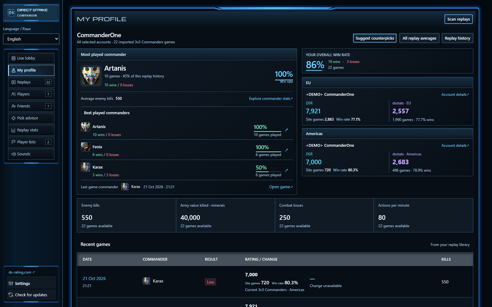
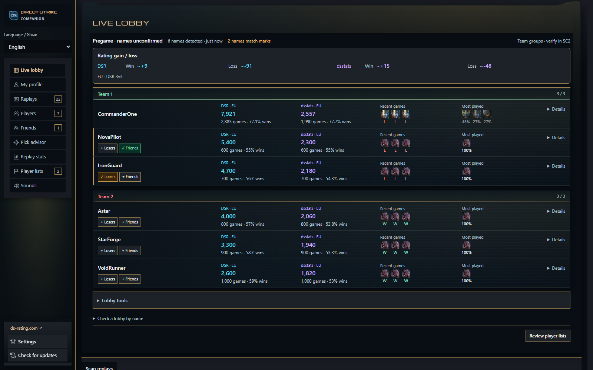
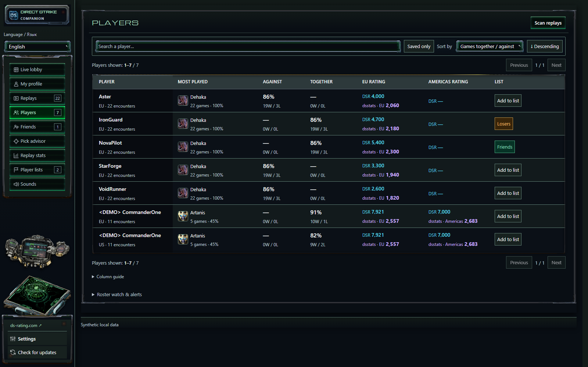
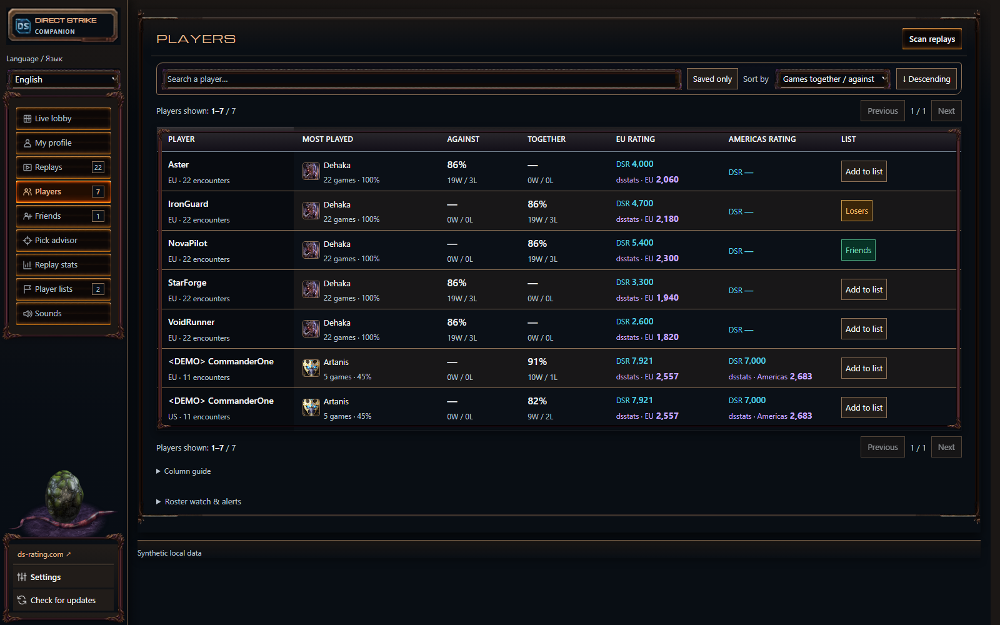
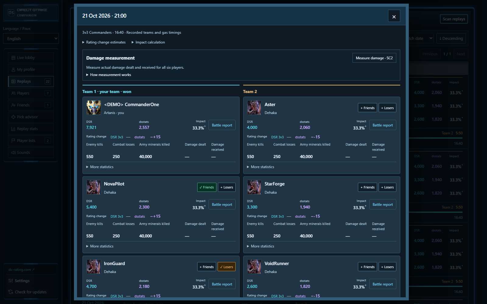

# Direct Strike Companion screenshots

Captured on 30 October 2026 from the application's actual interface at 1600 × 1000. The UI assets were hash-verified against local build **1.1.9-local.stats.9**. All accounts, replay results and ratings shown here are fictional demonstration data. Most captures use reduced motion; the Terran view includes a still frame of its equipment effects. The five completed views were checked for loaded images and demonstration names, then visually reviewed. An additional Settings capture was deferred after the resource guard stopped the browser during high system GPU load. These screenshots illustrate the current development build; the downloadable release may differ.

## My profile · Default

Commander history, account ratings, replay averages and recent results.



## Live lobby · Fenix / Purifier

Team rosters, player history and the rating gain/loss area in the Purifier interface.



## Players · Terran

The player list with Terran console artwork and equipment effects.



## Players · Zerg

Shared match history, win rates, regional ratings and saved player lists.



## Postgame summary · Default

Compare the two teams and open individual battle reports. Missing measurements remain marked as unavailable.



## Refreshing the gallery

After building locally and producing a successful packaged dashboard manifest, run from the source directory:

```powershell
pwsh -NoProfile -File verification/Run-RussianSoundWork.ps1 -Stage RepositoryGallery
```

The capture uses an isolated browser with synthetic API responses, blocks external requests and verifies visible images. It does not read the owner's replay library. Review the generated images before committing them. Screenshots stay in this documentation folder and are not bundled into the executable.
